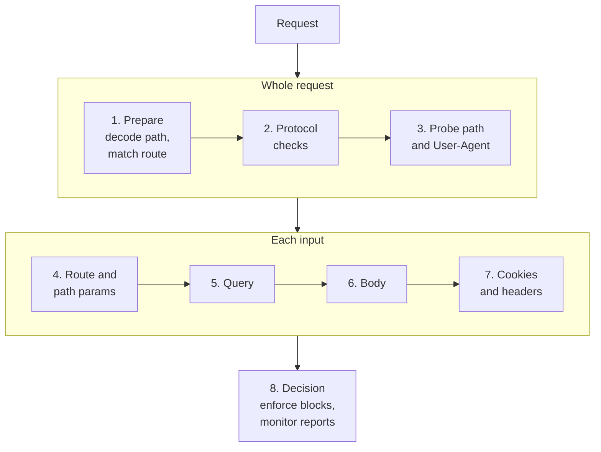
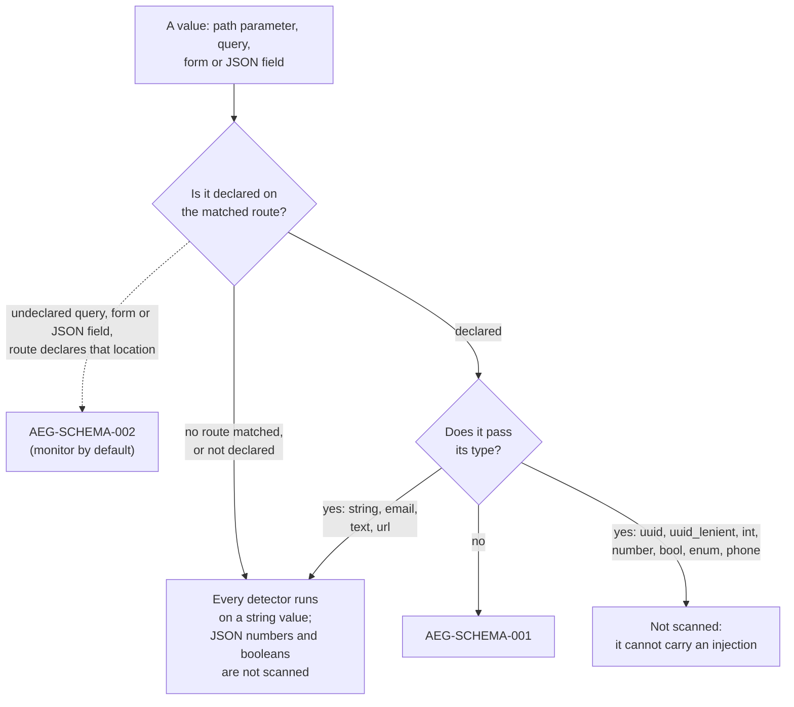

<div align="center">

# Aegolith

**The shield stone for Go APIs.**

A web application firewall library for Go that checks each request against the shape of your API<br>
before it runs attack detectors, and runs those detectors only where the input is free text.

[](LICENSE)
[](#status-and-roadmap)
[](CHANGELOG.md#v010-alpha6)
[](go.mod)

[Quick start](#quick-start) · [How it works](#how-it-works) · [Adapt it to your API](#adapt-it-to-your-api) · [Rules](#rules) · [Results](#corpus-results) · [Performance](#performance) · [Roadmap](#status-and-roadmap) · [Threat model](docs/threat-model.md)

</div>

> [!WARNING]
> **Aegolith is alpha.** The API can change, the rules are tuned on one corpus, and it does not catch everything. Run it in **monitor mode** first, read what it would have blocked, and only then turn on enforcement. Read the [threat model](docs/threat-model.md), including its list of known gaps, before you rely on it.

## At a glance

| Topic | Summary |
|---|---|
| **What it is** | A Go library. Middleware for `net/http` and Fiber v2, or call `Inspect` yourself. Not a proxy, not a service, no infrastructure. |
| **Latest release** | `v0.1.0-alpha.6`, 2026-11-26, for the core module and `adapters/fiberv2`. [What changed](#whats-new-in-alpha6). |
| **Requirements** | Go 1.25 or later. The core depends on the standard library and [libinjection-go](https://github.com/corazawaf/libinjection-go) only; Fiber lives in its own module. |
| **Cost per request** | 13.7 µs for a search GET and 19.2 µs for a JSON POST: lowest of four `make bench` rounds on an Apple M4 Pro laptop, no policy. A hostile 1 MiB body can cost about 0.45 s. The p99 budget of 50 µs was missed in some runs. [Details and caveats](#performance). |
| **Corpus** | 226 (no policy) and 227 (typed policy) of 230 attacks blocked, 0 of 195 legitimate requests flagged. The corpus was written by the people who tuned the rules. [Details](#corpus-results). |
| **Safe start** | Monitor mode does not block on matches; it reports what would have been blocked. With `fail_open` set to `false`, an internal error or panic still blocks. |
| **Not** | A CRS clone, a ModSecurity rule engine, a rate limiter, a bot filter, or a replacement for an edge or network WAF. |

<details>
<summary><b>Contents</b></summary>

- [Quick start](#quick-start)
  - [net/http](#nethttp)
  - [Fiber v2](#fiber-v2)
  - [Inspect without an adapter](#inspect-without-an-adapter)
- [How it works](#how-it-works)
- [Why it exists](#why-it-exists)
- [Adapt it to your API](#adapt-it-to-your-api)
  - [1. Start in monitor mode, with no configuration](#1-start-in-monitor-mode-with-no-configuration)
  - [2. Read the decisions](#2-read-the-decisions)
  - [3. Describe your routes](#3-describe-your-routes)
  - [4. Handle false positives: exclusions and rule actions](#4-handle-false-positives-exclusions-and-rule-actions)
  - [5. Cap the body and decide about compression](#5-cap-the-body-and-decide-about-compression)
  - [6. Enforce](#6-enforce)
  - [Settings reference](#settings-reference)
- [Supported languages and frameworks](#supported-languages-and-frameworks)
- [Rules](#rules)
- [What's new in alpha.6](#whats-new-in-alpha6)
- [Corpus results](#corpus-results)
- [Performance](#performance)
- [WAF bench (in progress)](#waf-bench-in-progress)
- [Status and roadmap](#status-and-roadmap)
  - [Known gaps](#known-gaps)
- [Contributing](#contributing) · [Security](#security) · [License](#license)

</details>

## Quick start

```sh
go get github.com/ergasterion-dev/aegolith@v0.1.0-alpha.6
```

### net/http

Monitor mode first: nothing is blocked, and every request that would have been blocked is logged.

```go
package main

import (
	"fmt"
	"log"
	"log/slog"
	"net/http"

	"github.com/ergasterion-dev/aegolith"
	"github.com/ergasterion-dev/aegolith/httpwaf"
)

func main() {
	// Monitor mode: nothing is blocked; matches are reported to the hook.
	fw, err := aegolith.New(aegolith.Config{Mode: aegolith.ModeMonitor})
	if err != nil {
		log.Fatal(err) // invalid configuration is reported at startup
	}

	mux := http.NewServeMux()
	mux.HandleFunc("/api/v1/products/search", func(w http.ResponseWriter, r *http.Request) {
		fmt.Fprintln(w, "ok")
	})

	// httpwaf.SlogHook logs Warn for blocks and Info for monitored requests,
	// with route, rule IDs, locations, fields, redacted snippets and latency
	// (never full values).
	handler := httpwaf.Middleware(fw, httpwaf.Options{
		OnDecision: httpwaf.SlogHook(slog.Default()),
	})(mux)

	log.Fatal(http.ListenAndServe(":8080", handler))
}
```

Chi, Gorilla and any other router built on `http.Handler` work through this middleware.

### Fiber v2

The adapter is its own Go module, so the core never pulls in Fiber:

```sh
go get github.com/ergasterion-dev/aegolith/adapters/fiberv2@v0.1.0-alpha.6
```

```go
fw, err := aegolith.New(aegolith.Config{Mode: aegolith.ModeMonitor})
if err != nil {
	log.Fatal(err)
}

app := fiber.New()
app.Use(fiberv2.New(fiberv2.Config{
	Firewall:   fw,
	OnDecision: httpwaf.SlogHook(slog.Default()), // from .../aegolith/httpwaf
	Next:       func(c *fiber.Ctx) bool { return c.Path() == "/healthz" },
}))
```

Fiber routes case-insensitively by default (`/API/v1/cart` reaches the `/api/v1/cart` handler). The adapter sees this and matches route policies the same way, unless you set `fiber.Config{CaseSensitive: true}`. More in [`adapters/fiberv2/README.md`](adapters/fiberv2/README.md).

### Inspect without an adapter

`Inspect` takes a transport-independent request and returns a decision:

```go
d := fw.Inspect(&aegolith.Request{
	Method:   "GET",
	RawPath:  "/api/v1/products/search",
	RawQuery: "q=1%27+OR+%271%27%3D%271",
	Header:   http.Header{},
})
// d.Action is allow or block; d.Monitored is true when matches were found
// but not enforced; d.Matches lists RuleID, Category, Location, Field and a
// redacted Snippet for each hit.
```

The same setups, in enforce mode and driven by `httptest`, run as tests: [`example_test.go`](example_test.go), [`httpwaf/example_test.go`](httpwaf/example_test.go) and [`adapters/fiberv2/example_test.go`](adapters/fiberv2/example_test.go). Every Go snippet in this README was also compiled against the current API (fragments inside a function) before this version of the page was published.

## How it works

Cheap checks run first. In enforce mode the first match whose action is `block` stops the rest of the work.



Every match passes through rule actions, then exclusions, then de-duplication (rule plus field) as soon as it is found, so an excluded match never stops the pipeline. Each value in steps 4 to 7 is handled like this (after `AEG-SCHEMA-002`, an undeclared string value is still scanned unless that match blocked in enforce mode, which stops the inspection; JSON numbers and booleans are not scanned, and path parameters never raise it):



| Stage | What it does |
|---|---|
| **Prepare** | Canonicalises header keys, percent-decodes the path once, and matches method and path template (`/orders/:id`, trailing `*`) on the **raw** path, so `%2F` cannot split or forge a segment. |
| **Protocol** | Method allow-list, content-type allow-list (for requests with a body), body size, CR/LF/NUL in path or headers, encoded and double-encoded traversal, `Transfer-Encoding` with anything but `chunked`, or with `Content-Length`. |
| **Probe path and User-Agent** | Scanner user agents and well-known probe paths. A probe-path match that lies wholly in literal segments of the matched route is not reported. |
| **Route, query, body, cookies, headers** | Walks JSON without building a tree, parses query strings, forms, cookies and multipart parts, bounded in depth, field count and value length. Typed values are validated; free-text and undeclared values get the detectors. |
| **Detectors** | libinjection for SQLi and XSS; curated rules for SQL time-delay tokens, command, code, LDAP, template, SSI, JNDI and CRLF injection, file and URL abuse, NoSQL and prototype-pollution keys, scanner paths and user agents. Linear in the value's length. |
| **Decision** | Applies the mode. Deterministic for a given config and request (apart from `Decision.Duration`, the time the inspection took). |

Design notes, the scan budget and why there is no CRS are in [docs/architecture.md](docs/architecture.md).

## Why it exists

Aegolith exists because of measurements on a real production API (Go and Fiber v2 on Kubernetes, with a server-side p95 target under 20 ms), taken on 2026-11-24. They are one team's numbers on one setup, not a general benchmark, but they set the design:

- Every option that runs the full OWASP Core Rule Set (CRS) on every request cost **1 to 2 ms of CPU per request** or more. Native Coraza v3.8.1 took 0.8 ms for a GET and 1.9 ms for a JSON POST on one Apple M4 Pro core. CrowdSec AppSec with CRS saturated at about 300 requests per second per core. Azure Front Door Premium managed rules added 2.4 to 2.9 ms in region and cost USD 330 per month.
- The open-source Traefik Coraza plugin (WebAssembly) was killed for running out of memory at 1 GiB, collapsed at 300 requests per second, and returned 500 on every request after memory corruption.
- Edge WAFs cost money (Front Door Standard is USD 35 per month with custom rules only) or add latency: for users in India, Cloudflare Free and Pro routed through Singapore and added 160 to 190 ms per call.
- A JSON API does not need 600 generic regex rules. Most fields have a known shape (a UUID, an integer, an enum), and a value that matches its shape cannot carry SQL injection. Heavy detection is only needed on the few free-text fields.

So Aegolith is a WAF that knows the API: protocol and request shape first (cheap), then proven detectors only where text is free. The aim is **tens of microseconds per request**, **zero infrastructure**, and a monitor mode you can put in production before you trust it. What it does not stop is listed in the [threat model](docs/threat-model.md#what-it-does-not-protect-against).

The name is Greek: *aigis*, the shield of Zeus and Athena, plus *lithos*, stone.

## Adapt it to your API

The path from "installed" to "enforcing" has six steps. You can stop at any of them: each one is safe on its own.

### 1. Start in monitor mode, with no configuration

`aegolith.Config{Mode: aegolith.ModeMonitor}` is a complete configuration. With no routes, every input is untyped and every string value gets every detector, and no match is blocked (`fail_open` defaults to `true`, so an internal error does not block either).

> [!IMPORTANT]
> The zero value of `Mode` is **enforce**. `aegolith.Config{}` blocks. Set `Mode: aegolith.ModeMonitor` (or `"mode": "monitor"` in a config file) explicitly until you have read the decisions.

### 2. Read the decisions

Run on real traffic for a while. The hook (`OnDecision`) is called for every blocked or monitored request and for every decision that carries an internal error, never for a clean allow. `httpwaf.SlogHook` logs it for you; to send it elsewhere, write your own:

```go
onDecision := func(r *aegolith.Request, d aegolith.Decision) {
	for _, m := range d.Matches {
		slog.Info("aegolith",
			"route", d.Route, // "METHOD /template" of the matched route, if any
			"monitored", d.Monitored,
			"rule", m.RuleID, "category", m.Category,
			"field", m.Field, // e.g. query.q, body.items[].note
			"action", m.Action,
			"snippet", m.Snippet, // redacted, at most 64 bytes; never the full value
		)
	}
	if d.Err != nil {
		slog.Error("aegolith internal error", "err", d.Err)
	}
}
handler := httpwaf.Middleware(fw, httpwaf.Options{OnDecision: onDecision})(mux)
```

| `Decision` field | Meaning |
|---|---|
| `Action` | `allow` or `block`. In monitor mode `allow`, except that an internal error or panic gives `block` when `fail_open` is `false`. |
| `Monitored` | True when matches were found but not enforced. |
| `Matches` | One entry per rule and field: `RuleID`, `Category`, `Severity`, `Location`, `Field`, redacted `Snippet`, `Action`. |
| `Route` | The matched route key (`"POST /api/v1/cart/items"`), empty when none matched. |
| `Err` | An internal error, resolved by `fail_open` (allow by default). |
| `Duration` | How long the inspection took. |

For every legitimate request that was flagged, do one of steps 3 or 4, or [report the false positive](#reporting-a-false-positive).

### 3. Describe your routes

Declare the routes you have and, per route, the types of path parameters, query values and JSON body fields. A value that passes a fully constrained type is not scanned, which removes most false positives and most of the cost. Anything you do not declare is still scanned.

```go
unknownFieldsBlock := aegolith.ActionBlock
fw, err := aegolith.New(aegolith.Config{
	Mode: aegolith.ModeEnforce,
	Routes: []aegolith.Route{{
		Method: "POST",
		Path:   "/api/v1/cart/items",
		Body: map[string]aegolith.Field{
			"product_id": {Type: aegolith.TypeUUID},
			"qty":        {Type: aegolith.TypeInt, Min: ptr(1), Max: ptr(99)},
			"note":       {Type: aegolith.TypeText, MaxLen: 500},
		},
		UnknownFields: &unknownFieldsBlock,
	}},
	Exclusions: []aegolith.Exclusion{{
		Rule:  "AEG-SQLI-*",
		Route: "GET /api/v1/products/search",
		Field: "query.q",
	}},
})

func ptr(f float64) *float64 { return &f }
```

The same structure loads from a JSON file with `aegolith.LoadConfig(path)`, which rejects unknown keys and trailing data. `New` validates everything and reports the first problem at startup.

<details>
<summary><b>The same policy as a JSON file</b></summary>

```json
{
  "mode": "monitor",
  "unknown_route": "monitor",
  "unknown_fields": "monitor",
  "inspect_headers": ["X-Api-Version"],
  "routes": [
    {
      "method": "GET",
      "path": "/api/v1/products/:id",
      "path_params": { "id": { "type": "uuid" } }
    },
    {
      "method": "POST",
      "path": "/api/v1/cart/items",
      "unknown_fields": "block",
      "body": {
        "product_id": { "type": "uuid" },
        "qty": { "type": "int", "min": 1, "max": 99 },
        "note": { "type": "text", "max_len": 500 }
      }
    }
  ],
  "exclusions": [
    { "rule": "AEG-SQLI-*", "route": "GET /api/v1/products/search", "field": "query.q" }
  ],
  "rule_actions": { "AEG-SCANNER-*": "monitor" }
}
```

Both this file and the Go example above are compiled and loaded by the tests in [`example_test.go`](example_test.go). A fuller policy is [`testdata/corpus/example-api-policy.json`](testdata/corpus/example-api-policy.json).

</details>

| Field type | Accepts | Scanned after it passes? |
|---|---|---|
| `uuid` | Canonical `xxxxxxxx-xxxx-xxxx-xxxx-xxxxxxxxxxxx`, hex in any case | No |
| `uuid_lenient` | Also the forms Go's `github.com/google/uuid` `Parse` takes (see below) | No |
| `int`, `number` | An integer or a number; `min` and `max` bound it | No |
| `bool` | A JSON boolean, or a string Go's `strconv.ParseBool` accepts (`true`, `false`, `1`, `0`, ...) | No |
| `enum` | One of the listed values | No |
| `phone` | An optional leading `+`, then digits, spaces and dashes, 7 to 15 digits | No |
| `string` | Optional `max_len` and `pattern` | Yes |
| `email` | An email address | Yes |
| `text` | Free text, optional `max_len` | Yes, full detector set |
| `url` | An absolute http(s) URL | Yes, plus the SSRF rules |

Field paths, in exclusions and in match results: `path.<param>`, `query.<name>`, `body.<json.path>` (arrays as `items[]`), `form.<name>`, `header.<lowercase name>`, `cookie.<name>`. A route key is `"METHOD /template"`, as declared.

<details>
<summary><b>When to use <code>uuid_lenient</code></b></summary>

`uuid` accepts only the canonical form, `xxxxxxxx-xxxx-xxxx-xxxx-xxxxxxxxxxxx`, hex digits in any case. If a handler parses ids with Go's `github.com/google/uuid` `Parse`, it also accepts 32 hex digits without dashes, the canonical form in braces (`{...}`) and a `urn:uuid:` prefix, so a strict `uuid` field blocks ids the application would take. Declare such a field `uuid_lenient` (`aegolith.TypeUUIDLenient`): it accepts exactly those four forms (hex and the `urn:uuid:` prefix in any ASCII case) and nothing else, so whitespace, NUL bytes, other brackets, nested braces and partial or over-long values are still `AEG-SCHEMA-001`. It is stricter than `Parse` in one respect: `Parse` takes any two bytes around a 38-byte value, while `uuid_lenient` requires `{` and `}`. In a config file it is `{ "type": "uuid_lenient" }`, like any other type. Use it only where the handler itself parses leniently (see the [threat model](docs/threat-model.md#what-it-does-not-protect-against)).

</details>

### 4. Handle false positives: exclusions and rule actions

Two tools, from narrow to broad:

- **An exclusion** drops one rule (or a selector) on one route and field. Use it when a field legitimately holds text that looks like an attack: `{ "rule": "AEG-SQLI-*", "route": "GET /api/v1/products/search", "field": "query.q" }`.
- **A rule action** changes what a rule does everywhere: `block`, `monitor`, or `allow` (drops the match).

```go
fw, err := aegolith.New(aegolith.Config{
	Mode: aegolith.ModeMonitor,
	RuleActions: map[string]aegolith.Action{
		"AEG-SCANNER-*": aegolith.ActionMonitor, // a prefix ending in *
		"AEG-PROTO-010": aegolith.ActionBlock,   // an exact ID
		"ssti":          aegolith.ActionMonitor, // a category
	},
})
```

A selector is an exact ID (`AEG-SQLI-001`), an ID prefix ending in `*` (`AEG-SQLI-*`, or `*`), or a category name (`sqli`). An exact ID beats the longest prefix, which beats the category. Rule actions apply first, then exclusions.

Excluding `AEG-SQLI-001` or `AEG-SSTI-001` on a field leaves the alpha.6 rules `AEG-SQLI-002` and `AEG-SSTI-002` on; exclude them by ID, or by a prefix such as `AEG-SQLI-*`.

### 5. Cap the body and decide about compression

These two steps are not optional before you enforce.

**Cap the request body at the server as well.** Only the first `max_body_bytes` (default 1 MiB) of a body are inspected. A longer body raises `AEG-PROTO-003`, which blocks by default, so an attack placed after 1 MiB of padding is refused in enforce mode. If you set it back to monitor with `"rule_actions": {"AEG-PROTO-003": "monitor"}` (for example to accept large uploads), the rest of the body is not inspected and padding bypasses Aegolith. Either way, limit the body at or below `max_body_bytes` in the server: `http.MaxBytesReader` (net/http has no limit by default) or `fiber.Config{BodyLimit: ...}` (Fiber's default, 4 MiB, is larger than 1 MiB), or at the reverse proxy. Raise `max_body_bytes` if you accept larger bodies.

**Decide about compressed request bodies.** net/http never decodes `Content-Encoding`, so a gzip body is inspected as compressed bytes and normally blocked (`AEG-LFI-001`, for the NUL bytes in it); decoding it after Aegolith is not supported. Fiber decodes `gzip`, `deflate` and `br` before inspection but not `x-gzip` or `zstd`. For an API, reject request `Content-Encoding` other than `identity` in front of Aegolith; if you must accept it, decode it in a middleware placed before Aegolith. Details in the [threat model](docs/threat-model.md#servers-and-encodings).

### 6. Enforce

When the log is quiet, switch to `Mode: aegolith.ModeEnforce` (or `"mode": "enforce"`). A blocked request gets `403` with `{"error":"request blocked","request_id":"..."}`. The body names no product and no rule. Both adapters take a custom `BlockHandler` and `RequestID`.

Unknown routes and unknown fields stay in monitor by default even in enforce mode, so a new endpoint does not break clients before the policy is updated. Once your routes cover the API, set `unknown_route` to `block`: a path that Aegolith does not match to a declared route is scanned, but its typed fields and `unknown_fields` action do not apply.

### Settings reference

| Key (JSON) | Default | What it does |
|---|---|---|
| `mode` | `enforce` | `enforce` blocks on a block match; `monitor` does not block on matches (an internal error still blocks when `fail_open` is `false`). |
| `routes` | none | Declared routes and their typed fields. With none, every input is untyped. |
| `unknown_route` | `monitor` | Action for a request matching no route, when routes are set (`AEG-ROUTE-001`). `monitor` or `block`. |
| `unknown_fields` | `monitor` | Action for an undeclared field on a matched route (`AEG-SCHEMA-002`), unless the route sets its own. `monitor` or `block`. |
| `exclusions` | none | `{rule, route, field}` entries that drop matches. |
| `rule_actions` | none | Selector to action (`block`, `monitor`, `allow`). |
| `inspect_headers` | none | Extra headers to scan. `User-Agent` and `Referer` are always scanned. |
| `allowed_methods` | `GET HEAD POST PUT PATCH DELETE OPTIONS` | Method allow-list (`AEG-PROTO-001`). |
| `allowed_content_types` | JSON, urlencoded form, multipart | Content-type allow-list for requests with a body (`AEG-PROTO-002`). |
| `allow_xml` | `false` | Also allow XML bodies and run the XXE rule on them. |
| `limits` | `max_body_bytes` 1 MiB, `max_depth` 32, `max_fields` 1,000, `max_value_len` 8 KiB | Bounds on the work per request. |
| `case_insensitive_routes` | `false` | Match literal route segments regardless of letter case. The Fiber adapter turns it on per request when Fiber routes case-insensitively. |
| `fail_open` | `true` | On an internal error, allow (`true`) or block (`false`). `Decision.Err` is set either way. |

`unknown_route` and `unknown_fields` cannot be set to `allow`; to silence them, set `AEG-ROUTE-001` or `AEG-SCHEMA-002` to `allow` in `rule_actions`.

### Reporting a false positive

A false positive is the most serious kind of bug in a WAF. Open an issue with the **False positive** template: give the rule ID, a made-up request that still triggers it (never real customer data) and your configuration. If an exclusion or a stricter field type fixed it for you, say so.

## Supported languages and frameworks

Aegolith is a Go library and supports Go only.

| Server | Status | How |
|---|---|---|
| `net/http` | Supported | [`httpwaf.Middleware`](httpwaf/middleware.go), in the core module |
| Chi, Gorilla and other `http.Handler` routers | Work through `net/http` | Same middleware |
| Fiber v2 | Supported | [`adapters/fiberv2`](adapters/fiberv2), a separate module (Fiber v2.52) |
| Fiber v3, Gin, Echo | Planned for v0.2 | See the [roadmap](#status-and-roadmap) |
| Anything else | Use `Inspect` | Build an `aegolith.Request` and act on the `Decision` |

## Rules

Every rule that the code can emit. Rule IDs are `AEG-<CATEGORY>-<NNN>` and are meant to stay stable. "Block" and "monitor" are the default action; change them with `rule_actions` or `exclusions`. In monitor mode no match is blocked whatever the action (an internal error still blocks when `fail_open` is `false`). Each rule's known gaps and false-positive shapes are in the [threat model](docs/threat-model.md#known-gaps-and-trade-offs).

<details open>
<summary><b>Protocol, route and schema</b> (13 rules)</summary>

| Rule | Category | Default | What it flags |
|---|---|---|---|
| `AEG-PROTO-001` | protocol | block | Method not in the allow-list. |
| `AEG-PROTO-002` | protocol | block | Body with a content type not in the allow-list. |
| `AEG-PROTO-003` | protocol | block | Body larger than `max_body_bytes`. The rest of the body is not inspected, so setting this rule to `monitor` lets padding hide an attack; cap the body at the server too (see [step 5](#5-cap-the-body-and-decide-about-compression)). |
| `AEG-PROTO-004` | protocol | block | CR, LF or NUL in the path (raw or decoded) or in a header value. |
| `AEG-PROTO-005` | protocol | block | Path traversal in the raw path (`../`, `..\`, `%2e%2e%2f`, `..%2f`, `%252e%252e%252f`). |
| `AEG-PROTO-006` | protocol | block | `Transfer-Encoding` other than `chunked`, or together with `Content-Length`. |
| `AEG-PROTO-007` | protocol | block | Double-encoded path. |
| `AEG-PROTO-010` | protocol | monitor | More than `max_fields` fields, or JSON nested deeper than `max_depth`. |
| `AEG-PROTO-011` | protocol | monitor | A value longer than `max_value_len` (scanned in windows), or the per-request scan budget ran out. |
| `AEG-PROTO-020` | protocol | monitor | Body that cannot be parsed (malformed JSON or multipart); the raw body is still scanned. |
| `AEG-ROUTE-001` | route | monitor | No declared route matches (when routes are configured). Set by `unknown_route`. |
| `AEG-SCHEMA-001` | schema | block | A declared field fails its type, or is an object or array where a scalar is declared. |
| `AEG-SCHEMA-002` | schema | monitor | A field the matched route does not declare. Set by the route's or config's `unknown_fields`. |

</details>

<details open>
<summary><b>Injection and file abuse</b> (17 rules)</summary>

| Rule | Category | Default | What it flags |
|---|---|---|---|
| `AEG-SQLI-001` | sqli | block | SQL injection (libinjection, also read from the keywords inside a value after leading words or padding), or stacked statements that copy to or from a program. Also run on JSON, query and form key names (the match names the key and carries no snippet). |
| `AEG-SQLI-002` | sqli | block | SQL time-delay and command-execution tokens as whole words: `WAITFOR DELAY` or `WAITFOR TIME` with a literal or `@variable`, `xp_cmdshell` (the bare name), and `pg_sleep(`, `pg_sleep_for(`, `pg_sleep_until(`, `DBMS_LOCK.SLEEP(`, `DBMS_SESSION.SLEEP(` calls; blanks and SQL comments between the parts. Also run on key names that are not plain identifiers. *New in alpha.6.* |
| `AEG-XSS-001` | xss | block | Cross-site scripting (libinjection), including `javascript:` URLs. |
| `AEG-CMDI-001` | cmdi | block | A shell operator followed by a known command used the way a shell is used, an absolute system path, a `$(...)` or `$((...))` substitution that does not read as a dollar amount, an `echo` probe after an operator, reverse-shell or Shellshock markers. |
| `AEG-CODEI-001` | codei | block | PHP open tags, `eval`/`assert` of `base64_decode`, Node `child_process` access. |
| `AEG-CODEI-002` | codei | block | A Java serialized object (`rO0AB`, `aced0005`). |
| `AEG-LDAP-001` | ldap | block | LDAP filter breakers (`*)(`, `)(\|`, `)(&`, `)(!`). |
| `AEG-SSTI-001` | ssti | block | Template expressions with code in them (`{{ ... }}` including Go template actions such as `printf` and `call` and filter pipes with a call, argument or sensitive name, `${T(`, `${7*7}`, `${a.b}` with a sensitive name and calls in `${...}`, any call, index, `*` or member access in `#{...}` except a plain data path that is not nested in another `#{`, `<%= %>`, ``). |
| `AEG-SSTI-002` | ssti | block | Server-side include directives: `<!--#` and `exec`, `include`, `echo`, `config`, `set`, `fsize` or `flastmod` with an attribute it takes, or `printenv` (`<!--#exec cmd=`, `<!-- #include file=`). `<!--#region-->` and `<!--#if-->` are clear. *New in alpha.6.* |
| `AEG-JNDI-001` | jndi | block | Log4Shell `${jndi:` lookups, including nested obfuscation. |
| `AEG-CRLF-001` | crlf | block | CR or LF (raw or encoded) followed by a response header name. |
| `AEG-LFI-001` | lfi | block | Directory traversal (`../`, encoded forms) or a NUL byte in a value. |
| `AEG-LFI-002` | lfi | block | Sensitive system file names (`/etc/passwd`, `/proc/self/`, `win.ini`, ...). |
| `AEG-RFI-001` | rfi | block | Wrapper and remote-include URLs (`file:`, `php://`, `gopher://`, `dict://`, `ldap://`, `expect://`, `jar:`, `data:text/html`, an http(s) URL ending in `?`). |
| `AEG-SSRF-001` | ssrf | block | A URL to a cloud metadata endpoint. |
| `AEG-SSRF-002` | ssrf | block | A URL to localhost, a loopback, private or link-local address. Not applied to `Referer`. |
| `AEG-XXE-001` | xxe | block | An XML `DOCTYPE` with an external identifier or an entity (only when `allow_xml` is set). |

</details>

<details open>
<summary><b>Keys, session identifiers and scanners</b> (7 rules)</summary>

| Rule | Category | Default | What it flags |
|---|---|---|---|
| `AEG-NOSQL-001` | nosqli | block | A JSON key that starts with `$` (a Mongo operator). |
| `AEG-NOSQL-002` | nosqli | block | A query or form key that carries a known MongoDB operator (`q[$ne]=1`, `$where=...`); `amount[$USD]` is not one. |
| `AEG-PPOLL-001` | protopollution | block | A JSON key `__proto__`, `constructor` or `prototype`; a query or form key with a `__proto__` segment or `constructor` then `prototype` in bracket or dot form (`__proto__[isAdmin]`, `a.constructor.prototype.x`). |
| `AEG-SESSION-001` | session | block | A session identifier in a query, form or JSON value (`PHPSESSID=`, `JSESSIONID=`, `ASPSESSIONID`). |
| `AEG-SCANNER-001` | scanner | block | A known scanner in `User-Agent` (sqlmap, nikto, nuclei, masscan, nmap, zgrab, wpscan, dirbuster, gobuster, ffuf, wfuzz, feroxbuster, hydra, acunetix, nessus, openvas, commix, netsparker, arachni, w3af, webinspect, havij, sqlninja, whatweb, detectify, jorgee, zmeu, paros, `qualys was`, and `vega` followed by `/`), as whole words. |
| `AEG-SCANNER-002` | scanner | block | A well-known probe path: `/wp-admin`, `/phpmyadmin`, `/actuator`, `/server-status`, secret dotfiles (`/.htpasswd`, `/.htaccess`, `/.git-credentials`, `/.npmrc`, `/.netrc`, `/.DS_Store`, shell histories, ...) and private keys (`/id_rsa`, ...) at the path start; `/.env`, `/.git/`, `/.aws/`, `/.ssh/`, `/wp-login.php` and the whole segments `.git`, `.svn`, `.hg`, `.bzr` at the start of any segment; and `/actuator/<endpoint>` (`env`, `heapdump`, ...) at any depth. Not raised for text that lies wholly in literal segments of a declared route the request matched (a route `GET /api/v1/stores/:id/actuator/health`). |
| `AEG-SCANNER-003` | scanner | block | A backup, editor or PHP file (`.bak`, `.old`, `.orig`, `.swp`, `.save`, `.php`, a trailing `~`), or a SQL dump, SQLite file or archive as the first segment (`/backup.sql`, `/users.sql.gz`, `/db.sqlite`, `/backup2026.zip`; deeper names such as `/api/v1/exports/orders.sql` and compressed web files such as `/sitemap.xml.gz` are clear). Not raised for a last segment spelled literally by a declared route. |

</details>

## What's new in alpha.6

`v0.1.0-alpha.6` was tagged on 2026-11-26 for the core module and for `adapters/fiberv2`, which now requires core alpha.6. It fixes the false positives found by an external validation of alpha.5 (public attack payload lists and benign text) and closes several cheap recall gaps. The full list is in the [changelog](CHANGELOG.md#v010-alpha6); every cost and accepted miss is in the [threat model](docs/threat-model.md#changes-in-alpha6-and-what-they-cost).

| Area | Change |
|---|---|
| **New rules** (block by default) | `AEG-SQLI-002` (SQL time-delay and command-execution tokens), `AEG-SSTI-002` (server-side include directives). |
| **Fewer false positives** | Percentages and size ranges in product text (SQLi); locale tokens in user agents, prose `&`, markdown backtick spans (CmdI); backticks in HTML comments, placeholder tags, a mention of `<!DOCTYPE` (XSS); placeholder filter pipes, `${t('cart.title')}`, plain `#{ }` data paths (SSTI). |
| **New detections** | `$(...)` substitutions and `echo` probes after an operator; more template shapes; VCS directories at any depth, secret dotfiles, root SQL dumps and archives, and 14 more scanner user agents. |
| **Behaviour change** | A probe-path match is not reported when the text lies wholly in literal segments of the declared route the request matched, so `GET /api/v1/stores/:id/actuator/health` clears its own `actuator/health`. |
| **New false positives to expect** | Shell snippets with `$(...)`, the bare name `xp_cmdshell`, a quoted server-side include, an archive or SQL file served as the first path segment (`/app.zip`), an application whose user-agent token is a scanner word (`Paros/2.1`). |
| **Corpus** | 230 attacks and 195 legitimate requests (was 137 and 130), 0 false positives. |
| **Speed** | Slower than alpha.5 on identical requests: search GET and cart POST benchmarks 14 to 21%, worst-case bodies 4 to 6%, median p99 latency 11 to 24% (release measurements). See [Performance](#performance). |

> [!NOTE]
> **On `main` but not in the tag.** After the core tag, `main` gained documentation (a known gap found after tagging, declared templates that end in `/`, [listed below](#known-gaps); tighter adapter notes; comments in `internal/engine/inputs.go`), one adapter test (`adapters/fiberv2/scanner_route_test.go`) and the adapter's pin to core alpha.6 in its `go.mod`. No core Go code that runs changed; the adapter tag `adapters/fiberv2/v0.1.0-alpha.6` includes all of this. After both tags, `main` gained the [WAF bench](#waf-bench-in-progress), a separate module in `bench/` that is not part of any release, and `make build`, `test`, `test-quick` and `vet` now also cover it.

## Corpus results

The acceptance corpus in [`testdata/corpus`](testdata/corpus) has **230 attacks and 195 legitimate requests**: an attack and false-positive suite taken from a production API's tests (107 attacks and 32 legitimate requests), plus 123 attacks and 163 legitimate requests added for Aegolith (prose with `&`, `;`, `#`, `<`, `%`, Urdu and Hindi text, apostrophes, links in reviews, decimal prices, multipart uploads). It runs twice in enforce mode with **no exclusions**:

- **Generic**: no routes, every input untyped. Gate: at least 226 of 230 blocked.
- **API-aware**: a route policy that types the fields. Gate: at least 227 of 230 blocked, and every legitimate request must fit the policy.

Both gates also require **0 false positives**. Output of `make corpus` (`go test -run Corpus -v .`) on 2026-11-27, at commit `7ec9018`:

| Category | Generic blocked | API-aware blocked | Total |
|---|--:|--:|--:|
| sqli | 47 | 47 | 47 |
| xss | 23 | 23 | 23 |
| lfi | 11 | 11 | 11 |
| rfi | 3 | 3 | 3 |
| cmdi | 29 | 29 | 29 |
| ssti | 38 | 38 | 38 |
| log4shell | 3 | 4 | 4 |
| ssrf | 5 | 5 | 5 |
| xxe | 3 | 3 | 3 |
| nosqli | 2 | 2 | 3 |
| codei | 8 | 8 | 8 |
| protocol | 6 | 6 | 7 |
| scanner | 46 | 46 | 46 |
| session | 1 | 1 | 1 |
| misc | 1 | 1 | 2 |
| **Attacks** | **226** | **227** | **230** |
| **False positives** | **0** | **0** | **195** |

**What it misses** (4 attacks generic, 3 API-aware; all four were also missed before alpha.4 and are unchanged in alpha.6):

| Attack | Generic | API-aware | Why |
|---|---|---|---|
| protocol / content-type abuse | missed | missed | A `GET` with no body and an odd `Content-Type`. The allow-list only applies to requests with a body, so nothing parses the header. |
| nosqli / operator in query | missed | missed | The attack is `q=[$ne]=1`: the operator is inside a query value, not a key. As a value it is inert text; the real shape `q[$ne]=1` is caught. |
| misc / xpath injection | missed | missed | libinjection does not flag it and there is no XPath detector in v0.1. |
| log4shell / obfuscated jndi | missed | blocked | The lookup is in `X-Api-Version`, which is scanned only when listed in `inspect_headers`. The generic configuration scans `User-Agent` and `Referer` only. |

**The corpus came from the same team that tuned the rules, so these numbers show the rules fit it, not that they will fit your traffic.** That is why monitor mode comes first. The corpus README also lists the [accepted recall trade-offs](testdata/corpus/README.md#accepted-recall-trade-offs-not-in-the-corpus) that the corpus does not exercise. Independent results will come from the [WAF bench](#waf-bench-in-progress), which is not finished.

## Performance

Measured on a developer laptop, not a server, on 2026-11-27 at commit `7ec9018`. The Go code that runs is the same as in the `v0.1.0-alpha.6` tag (only comments changed since). The commands are at the end of this section.

| Item | Value |
|---|---|
| CPU | Apple M4 Pro (14 cores) |
| Go | go1.25.12 darwin/arm64, GOMAXPROCS 14 |
| Load | The laptop was not idle: a virtual machine and desktop applications were running. Load average at the start and end of the runs, over 1 and 5 minutes: benchmarks 6.1 to 13.2 and 4.8 to 10.4; latency 7.6 to 10.8 and 7.0 to 9.4. |

> [!WARNING]
> **The latency budget did not hold in every run, with either release.** The spec asks for p99 under 50 µs per typical request on one core.
>
> - **This page (2026-11-27, alpha.6 code):** 1 of 6 runs was over budget, generic with browser headers at p99 53.0 µs.
> - **Release measurements (2026-11-26, commit `b0c0ec0`):** alpha.6 was over budget in 3 of 12 runs on its own 195 requests (p99 up to 84.7 µs) and in 4 of 12 on alpha.5's 130 requests and policy (up to 87.0 µs); alpha.5 was over in 4 of 12 (up to 111.8 µs). The slowest single request in those runs took 19.5 ms.
>
> In the runs recorded here, every row over budget had browser headers. Measure on your own hardware before you rely on the budget.

**Benchmarks** (`make bench`, `go test -run '^$' -bench . -benchmem ./...`). Four rounds were run, and each number is the **lowest of all four**. Round 3 started with a 1-minute load of 11.4; none of its cells was the lowest, so leaving it out would change nothing. "Generic" is no policy, "api-aware" is the typed corpus policy.

| Benchmark | Generic | API-aware | Allocs/op (generic) |
|---|--:|--:|--:|
| `Inspect`, search GET (query string, browser headers) | 13.7 µs | 12.9 µs | 144 |
| `Inspect`, JSON cart POST | 19.2 µs | 17.3 µs | 252 |
| `Inspect`, the legitimate corpus requests, per request (195 requests) | 6.3 µs | 4.9 µs | 91 |
| `Inspect`, a 500-field JSON body | 363 µs | 360 µs | 9,439 |
| `ScanText` on a short word | 112 ns | | 1 |
| `ScanText` on a short prose sentence | 3.3 µs | | 59 |
| `ScanText` on a SQLi payload | 0.97 µs | | 17 |

**Latency budget** (`make perf`, `AEGOLITH_PERF=1 go test -run LatencyBudget -v .`), alpha.6 on its 195 legitimate corpus requests, with and without a realistic set of browser headers. Six runs were made and every run is counted; 1 of the 6 was over budget. Columns: lowest p50 of the six runs, lowest p99, highest p99, and highest max (the slowest single request in any run).

| Configuration | Lowest p50 | Lowest p99 | Highest p99 | Highest max |
|---|--:|--:|--:|--:|
| generic, corpus requests | 5.4 µs | 15.5 µs | 18.0 µs | 363 µs |
| generic, with browser headers | 14.0 µs | 23.3 µs | **53.0 µs (over budget)** | 690 µs |
| api-aware, corpus requests | 3.8 µs | 11.3 µs | 20.8 µs | 799 µs |
| api-aware, with browser headers | 12.8 µs | 22.5 µs | 40.6 µs | 1.62 ms |

**Worst case.** Cost is linear in the input and bounded, but a hostile large body is not cheap. The adversarial 1 MiB bodies in `BenchmarkInspectWorstCase` (lowest of all four rounds):

| Body | Time | Allocated |
|---|--:|--:|
| repeated invalid UTF-8 plus `<`, trailing SQLi | 453 ms | 128 MB |
| many tags, trailing SQLi | 290 ms | 96 MB |
| many tags in one value | 148 ms | 50 MB |

More than half of the worst case is spent inside libinjection-go: 54 to 63% of all CPU samples, garbage collection included, in CPU profiles of these three bodies at commit `b0c0ec0` (the same detector code; not re-profiled for this page). Front the service with a body size limit set to what you actually accept; see [resource bounds](docs/threat-model.md#resource-bounds).

<details>
<summary><b>Release measurements (2026-11-26, commit <code>b0c0ec0</code>) and the comparison with alpha.5</b></summary>

These were taken on the same laptop for the alpha.6 release, alternating with alpha.5, and are kept here because they compare the two releases. Load average at the start and end of the alpha.6 runs (both request sets), over 1 and 5 minutes: quoted benchmarks, 6.1 to 9.3 and 8.4 to 9.1; latency session 1, 4.7 to 10.5 and 7.7 to 10.0; latency session 2, 3.7 to 5.5 and 5.0 to 5.8.

**Benchmarks.** Six rounds were run, alternating with alpha.5. Each number is the lowest of the last three (rounds 4 to 6): two alpha.6 runs in rounds 1 to 3 ended with a 5-minute load above 10, the level each run had to start below (10.47 and 12.45). The lowest of all six differs in one cell (500-field body, api-aware: 381 µs).

| Benchmark | Generic | API-aware | Allocs/op (generic) |
|---|--:|--:|--:|
| `Inspect`, search GET | 14.3 µs | 13.1 µs | 144 |
| `Inspect`, JSON cart POST | 19.9 µs | 18.0 µs | 252 |
| `Inspect`, legitimate corpus requests, per request | 6.3 µs | 5.0 µs | 91 |
| `Inspect`, a 500-field JSON body | 382 µs | 382 µs | 9,439 |
| `ScanText` on a short word | 115 ns | | 1 |
| `ScanText` on a short prose sentence | 3.5 µs | | 59 |
| `ScanText` on a SQLi payload | 0.98 µs | | 17 |

Worst-case bodies, same rounds: 460 ms / 128 MB, 298 ms / 96 MB, 149 ms / 50 MB.

Against `v0.1.0-alpha.5`, run the same way on the same machine in the same session: the search GET and cart POST benchmarks are 14 to 21% slower, the 500-field body 3 to 4%, the three `ScanText` rows above 7 to 10% (the short word went from 105 to 115 ns) and the worst-case bodies 4 to 6%. The corpus grew from 130 to 195 legitimate requests, so for that row both releases were also run on alpha.5's requests and policy: alpha.6 is 7% slower generic and 17% slower api-aware.

Rounds 1 to 3 alone read higher for alpha.6: search GET 14.9 / 13.3 µs, cart POST 20.1 / 18.7 µs and worst-case bodies 467 / 334 / 152 ms, which would put search GET and cart POST 14 to 24% and the worst-case bodies 5 to 17% behind alpha.5.

**Latency budget.** There were two sessions of six runs each, alpha.6 and alpha.5 interleaved: the first started each run with a 5-minute load below 10, the second below 6. Every run is counted. alpha.6 on its 195 legitimate corpus requests, over all 12 runs:

| Configuration | p50 | Lowest p99 | Highest p99 | Highest max |
|---|--:|--:|--:|--:|
| generic, corpus requests | 5.4 µs | 14.9 µs | 39.3 µs | 19.5 ms |
| generic, with browser headers | 13.8 µs | 23.8 µs | **65.7 µs (over budget)** | 6.9 ms |
| api-aware, corpus requests | 3.8 µs | 11.5 µs | 25.6 µs | 1.7 ms |
| api-aware, with browser headers | 12.5 µs | 22.4 µs | **84.7 µs (over budget)** | 1.3 ms |

A run counts as over budget when any of its four rows has a p99 of 50 µs or more:

| Code and requests | Session 1 | Session 2 | Runs over budget | Rows over budget | p99 of those rows (µs) |
|---|---|---|---|---|---|
| alpha.6, its 195 requests | 2 of 6 | 1 of 6 | 3 of 12 | 3 of 48 | 56.0, 65.7, 84.7 |
| alpha.6, alpha.5's 130 requests and policy | 3 of 6 | 1 of 6 | 4 of 12 | 4 of 48 | 62.5, 68.3, 68.7, 87.0 |
| alpha.5, its 130 requests | 1 of 6 | 3 of 6 | 4 of 12 | 7 of 48 | 56.5, 60.8, 65.8, 84.8, 89.8, 111.6, 111.8 |

Every row over budget is one with browser headers. Taking both request sets together, alpha.6 was over budget in 7 of 24 runs and alpha.5 in 4 of 12. The second session shows that the misses are not specific to alpha.6 (alpha.5 missed in 3 of 6 runs there, alpha.6 in 1 of 6 on each request set, though two of those alpha.5 runs started while another process on the laptop was using about four cores in one case and about nine in the other) and that a 5-minute load below 6 did not stop them. The runs do not establish the cause, and they do not show that either release holds the budget in every run; that needs a quiet server. The strict check only runs with `AEGOLITH_PERF=1` and is a coarse sanity bound otherwise.

**On identical requests alpha.6 is slower.** With alpha.6 on alpha.5's requests and policy, the median over 12 runs of each row is 13 to 19% higher than alpha.5's for p50 and 11 to 24% higher for p99. The lowest single p50 of the 12 is 11 to 22% higher; the lowest single p99 is mixed, from 10% lower to 10% higher.

</details>

<details>
<summary><b>Reproduce</b></summary>

```sh
sysctl -n machdep.cpu.brand_string && go version && uptime   # machine, Go, load
make bench      # benchmarks: run it several times; the text above says which runs are quoted
make perf       # latency p50, p99, max: one run per call
make corpus     # the corpus tables

# alpha.5, for the comparisons: run the same two targets in a second clone
git clone --branch v0.1.0-alpha.5 https://github.com/ergasterion-dev/aegolith ../aegolith-alpha5

# alpha.6 on alpha.5's requests and policy (in a scratch clone), then restore
git checkout v0.1.0-alpha.5 -- testdata/corpus/legit.jsonl testdata/corpus/example-api-policy.json
make perf
go test -run '^$' -bench InspectLegitCorpus -benchmem .
git checkout HEAD -- testdata/corpus

# libinjection-go share: one CPU profile per worst-case body; read the "% of total" line
go test -run '^$' -bench 'InspectWorstCase/ff-lt-trailing-sqli$' -benchtime 30x -cpuprofile cpu.out .
go tool pprof -top -nodefraction=0 -focus=libinjection-go cpu.out
```

</details>

## WAF bench (in progress)

The corpus above was written by the people who tuned the rules. The WAF bench in [`bench/`](bench) is meant to measure Aegolith against attack sets the project did not write, over HTTP, and to publish reproducible reports. The [design](docs/superpowers/specs/2026-11-26-waf-bench-design.md) and the [plan](docs/superpowers/plans/2026-11-26-waf-bench.md) are in the repository.

> [!IMPORTANT]
> **No independent results are published yet.** The two third-party sets, the OWASP Core Rule Set regression tests (v4.31.0, Apache-2.0) and GoTestWAF (v0.5.11, MIT), are pinned by commit in [`bench/sources.json`](bench/sources.json). Both can be imported into case lines; no run against either set has been published.

| Part | State |
|---|---|
| Case model, baseline importer (the project corpus) | Done |
| Target server (net/http middleware, monitor or enforce, optional policy), access and decision logs | Done |
| Detection runner (loopback targets only), report and comparison with an earlier report | Done |
| Source pinning, fetch script, rewriting callback hosts to `callback.invalid` | Done |
| CRS regression test importer (stages that cannot be sent as one HTTP/1.1 request are skipped and counted) | Done |
| GoTestWAF importer (one case per payload, encoder and placeholder, built as the tool builds its requests; gRPC and GraphQL cases are skipped and counted) | Done |
| A large legitimate-traffic set | Not started |
| Load phase, guarded remote mode, one-command `make` targets, first report | Not started |

The commands that exist now, run from `bench/` (the target runs in a second terminal; `bench/out/` is git-ignored):

```sh
cd bench
go run ./cmd/aegobench help

# 1. Convert the project corpus into case lines
go run ./cmd/aegobench import --source baseline --corpus ../testdata/corpus --out out/baseline.jsonl

# 1b. Optional: fetch the pinned third-party sets and convert them
./scripts/fetch-sources.sh
go run ./cmd/aegobench import --source crs --root .sources/crs --out out/crs.jsonl --skipped out/crs-skipped.jsonl
go run ./cmd/aegobench import --source gotestwaf --root .sources/gotestwaf --out out/gotestwaf.jsonl --skipped out/gotestwaf-skipped.jsonl

# 2. In a second terminal: the firewall-wrapped target (127.0.0.1:8088, admin on :8089)
go run ./cmd/aegobench target --mode enforce --policy ../testdata/corpus/example-api-policy.json \
  --access out/access.jsonl --decisions out/decisions.jsonl

# 3. Send every case once and join the answers with the target's logs
go run ./cmd/aegobench detect --cases out/baseline.jsonl --base http://127.0.0.1:8088 \
  --access out/access.jsonl --decisions out/decisions.jsonl --out out/results.jsonl

# 4. Write out/report/report.md and report.json (add --previous to compare)
go run ./cmd/aegobench report --cases out/baseline.jsonl --results api-aware=out/results.jsonl --out out/report
```

`bench/scripts/fetch-sources.sh` fetches the two pinned sources into `bench/.sources/` (it needs git, jq and network access, and runs nothing it fetches). `detect` refuses any host but a loopback one; remote mode is not built.

## Status and roadmap

Aegolith v0.1 is **alpha**. What that means:

- **Alpha release (`v0.1.0-alpha.6`, see the [changelog](CHANGELOG.md)).** Pin the version. The public API, the config format and rule behaviour can change without notice before a release.
- **Tuned on one corpus.** It blocks 226 and 227 of the 230 corpus attacks with no false positives on 195 legitimate requests. That says nothing about your traffic. Start in monitor mode.
- **Not promised:** that it catches every attack in a class, that it never flags a legitimate request, protection against anything in [what it does not protect against](docs/threat-model.md#what-it-does-not-protect-against), or a fixed upgrade path for config files.
- **Your responsibilities remain:** parameterised queries, output escaping, authorization checks, rate limiting and a body size limit in front of the service (at or below `max_body_bytes`; see [step 5](#5-cap-the-body-and-decide-about-compression)).

### Roadmap

- [x] Engine: protocol checks, route policies with typed fields, detectors, exclusions, monitor and enforce modes
- [x] `net/http` middleware and Fiber v2 adapter, decision hook with a `log/slog` helper
- [x] Corpus gates, fuzz tests, benchmarks and a latency budget
- [x] Architecture and threat-model documents
- [x] First tagged release
- [ ] WAF bench with third-party attack sets and published reports ([in progress](#waf-bench-in-progress))
- [ ] v0.2: generate route policies from Go structs or OpenAPI
- [ ] v0.2: Fiber v3, Gin and Echo adapters (Chi and Gorilla already work through `net/http`)
- [ ] v0.2: optional Coraza-backed engine for a few risky routes

### Known gaps

The full list, with the reasons, is in the [threat model](docs/threat-model.md#known-gaps-and-trade-offs). The ones most likely to surprise you:

- **Body over the limit.** Only the first `max_body_bytes` of a body are inspected. `AEG-PROTO-003` blocks a longer body by default; if you set it to `monitor`, an attack after the padding is not seen.
- **Data after a JSON value.** A body with data after its first JSON value is malformed, so it gets a raw rescan that quote-parity padding can evade (`{"a":"x"}'{"q":"1' OR '1'='1"}` is allowed). No standard-library Go decoder reads that trailing value.
- **Non-UTF-8 JSON charsets** (`charset=utf-16`, `iso-8859-1`) are accepted by the content-type check. This fails safe: the body is inspected as UTF-8 bytes, and UTF-16 is blocked for its NUL bytes.
- **Worst-case cost.** A hostile 1 MiB body can cost about 0.45 s of CPU on an Apple M4 Pro and 128 MB of allocation (see [Performance](#performance)); the same body took up to 0.66 s while that laptop was loaded, and slower hardware takes longer. In monitor mode an over-cap body of 2 MiB+1 bytes (the Fiber adapter hands over that much) measured about 0.44 s and 145 MB. The scan budget is kept at 8x the body limit on purpose.
- **Declared templates that end in `/`** (found after the alpha.6 tag). With `GET /actuator/health/` declared, `GET /actuator/health` is not flagged by the scanner path rules (alpha.5 flagged it), and another handler may answer it: Fiber with `StrictRouting` serves it with a later `/actuator/:ep`, `/actuator/*` or catch-all handler, if there is one, when the template has no parameter; Go's `ServeMux` serves it with a pattern that matches the slashless path itself, such as `/actuator/{ep}`. If another handler could answer that path, register the route and declare its template without the final slash. Details in the [threat model](docs/threat-model.md#known-gaps-found-in-the-alpha6-review).

<details open>
<summary><b>Recall traded for fewer false positives, and new false positives in alpha.6</b></summary>

- **Recall traded for fewer false positives:** `x & cat /flag.txt` (no flag, after a prose `&`) and `Location:evil.com` in a value are allowed.
- **Recall traded for fewer false positives (XSS, alpha.6):** five shapes are allowed: `javascript: a=1; alert (x)` (plain spaces, one plain word or blank-separated words as the argument), a bare `<object>`/`<link>`/`<base>`/`<meta>`/`<embed>` with no attribute on any tag, a `<!DOCTYPE` with no `>` or `[` after it, a backtick inside an HTML or bogus comment when nothing else in the value is flagged (no raw-text or form element, no handler, script or `javascript:` text, nothing libinjection flags with the comments read as live), and a JavaScript-string breakout followed by such a comment (``';alert(1)//<!--`-->``). The exact list is in the [threat model](docs/threat-model.md#changes-in-alpha6-and-what-they-cost). Real markup next to them is still caught.
- **Recall traded for fewer false positives (alpha.6):** `1-1 or 1` and `9% (a) or 1` (SQL tautologies with no comparison that look like sizes or percentages), `$(pwd)` and other unlisted one-word substitutions in a prose shape, a two-letter command in a User-Agent comment, any command word with letter-only flags in a prose backtick span (``a `whoami` b``), bare template pipes such as `{{ x|config }}`, and `#{ }` data paths, which can still call a zero-argument method (`#{order.destroy}`).
- **New false positives in alpha.6:** shell snippets with `$(...)`, the bare name `xp_cmdshell`, a quoted server-side include, an archive or SQL file served as the first path segment (`/app.zip`), and an application whose user-agent token is a scanner word (`Paros/2.1`). Exclude the rule on that field or route.

</details>

## Contributing

Contributions are welcome. The easiest useful one needs no knowledge of the engine: [add a corpus case](CONTRIBUTING.md#add-a-corpus-case), a legitimate request that is wrongly flagged or an attack that is missed. Read [CONTRIBUTING.md](CONTRIBUTING.md) first; the checks are `make ci` and the pre-commit hook.

This project follows the [Contributor Covenant](CODE_OF_CONDUCT.md).

## Security

Found a vulnerability in Aegolith itself? **Don't open a public issue.** Please [report it privately](https://github.com/ergasterion-dev/aegolith/security/advisories/new). See [SECURITY.md](SECURITY.md).

## License

[Apache License 2.0](LICENSE). Third-party attributions are in [NOTICE](NOTICE).
