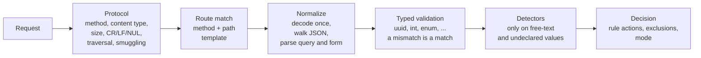

<div align="center">

# Aegolith

**The shield stone for Go APIs.**

An API-aware web application firewall library for Go.<br>
It checks the protocol and the shape of each request first, then runs targeted attack detectors only where the input is free text.<br>
Middleware for `net/http` and Fiber v2. Tens of microseconds per request, no infrastructure, safe to run in monitor mode first.

[](LICENSE)
[](#status-and-roadmap)
[](https://go.dev)
[](CONTRIBUTING.md)

[Why](#why) · [Quick start](#quick-start) · [How it works](#how-it-works) · [Route policies](#route-policies) · [Rules](#rules) · [Corpus results](#corpus-results) · [Performance](#performance) · [Status](#status-and-roadmap) · [Architecture](docs/architecture.md) · [Threat model](docs/threat-model.md) · [Contributing](CONTRIBUTING.md) · [Security](SECURITY.md)

</div>

> [!WARNING]
> **Aegolith is pre-alpha.** The API can change, the rules are tuned on one corpus, and it does not catch everything. Run it in **monitor mode** first, read what it would have blocked, and only then turn on enforcement. Read the [threat model](docs/threat-model.md), including its list of known gaps, before you rely on it.

The name is Greek: *aigis*, the shield of Zeus and Athena, plus *lithos*, stone. The shield stone.

## Why

Aegolith exists because of measurements on a real production API (Go and Fiber v2 on Kubernetes, with a server-side p95 target under 20 ms), taken on 2026-11-24. They are one team's numbers on one setup, not a general benchmark, but they set the design:

- Every option that runs the full OWASP Core Rule Set (CRS) on every request cost **1 to 2 ms of CPU per request** or more. Native Coraza v3.8.1 took 0.8 ms for a GET and 1.9 ms for a JSON POST on one Apple M4 Pro core. CrowdSec AppSec with CRS saturated at about 300 requests per second per core. Azure Front Door Premium managed rules added 2.4 to 2.9 ms in region and cost USD 330 per month.
- The open-source Traefik Coraza plugin (WebAssembly) was killed for running out of memory at 1 GiB, collapsed at 300 requests per second, and returned 500 on every request after memory corruption.
- Edge WAFs cost money (Front Door Standard is USD 35 per month with custom rules only) or add latency: for users in India, Cloudflare Free and Pro routed through Singapore and added 160 to 190 ms per call.
- A JSON API does not need 600 generic regex rules. Most fields have a known shape (a UUID, an integer, an enum), and a value that matches its shape cannot carry SQL injection. Heavy detection is only needed on the few free-text fields.

So Aegolith is a WAF that knows the API. It checks protocol and request shape first (cheap), then runs proven detectors (libinjection for SQLi and XSS, a curated rule set for the rest) only where text is free. The aim: **tens of microseconds per request**, **zero infrastructure**, and a monitor mode you can put in production before you trust it.

Things it deliberately is not: a CRS clone, a ModSecurity-rule engine, a rate limiter, a bot filter or a replacement for an edge or network WAF. See [what it does not protect against](docs/threat-model.md#what-it-does-not-protect-against).

## Quick start

You need Go 1.25 or later. The core module depends on the standard library and [libinjection-go](https://github.com/corazawaf/libinjection-go) only.

```sh
go get github.com/ergasterion-dev/aegolith@v0.1.0-alpha.6
```

(This is an alpha release; see [Status](#status-and-roadmap).)

### net/http, monitor mode first

```go
package main

import (
	"fmt"
	"log"
	"log/slog"
	"net/http"

	"github.com/ergasterion-dev/aegolith"
	"github.com/ergasterion-dev/aegolith/httpwaf"
)

func main() {
	// Monitor mode: nothing is blocked; matches are reported to the hook.
	fw, err := aegolith.New(aegolith.Config{Mode: aegolith.ModeMonitor})
	if err != nil {
		log.Fatal(err) // invalid configuration is reported at startup
	}

	mux := http.NewServeMux()
	mux.HandleFunc("/api/v1/products/search", func(w http.ResponseWriter, r *http.Request) {
		fmt.Fprintln(w, "ok")
	})

	// httpwaf.SlogHook logs Warn for blocks and Info for monitored requests,
	// with route, rule IDs, locations, fields, redacted snippets and latency
	// (never full values).
	handler := httpwaf.Middleware(fw, httpwaf.Options{
		OnDecision: httpwaf.SlogHook(slog.Default()),
	})(mux)

	log.Fatal(http.ListenAndServe(":8080", handler))
}
```

### Fiber v2

The Fiber adapter is its own Go module, so the core never pulls Fiber:

```sh
go get github.com/ergasterion-dev/aegolith/adapters/fiberv2@v0.1.0-alpha.6
```

```go
fw, err := aegolith.New(aegolith.Config{Mode: aegolith.ModeMonitor})
if err != nil {
	log.Fatal(err)
}

app := fiber.New()
app.Use(fiberv2.New(fiberv2.Config{
	Firewall:   fw,
	OnDecision: httpwaf.SlogHook(slog.Default()), // from .../aegolith/httpwaf
	Next:       func(c *fiber.Ctx) bool { return c.Path() == "/healthz" },
}))
```

The snippets above are not themselves compiled. The same setup, in enforce mode and driven by `httptest` instead of a listening server, is compiled and run as the examples in [`httpwaf/example_test.go`](httpwaf/example_test.go) and [`adapters/fiberv2/example_test.go`](adapters/fiberv2/example_test.go). More on the adapter in [`adapters/fiberv2/README.md`](adapters/fiberv2/README.md).

Fiber routes case-insensitively by default (`/API/v1/cart` reaches the `/api/v1/cart` handler). The adapter sees this and matches route policies the same way, unless you set `fiber.Config{CaseSensitive: true}`. For another case-insensitive router, set `case_insensitive_routes: true`.

### Turning on enforcement

1. Run with `Mode: aegolith.ModeMonitor` and a hook for a while on real traffic. A monitored request is allowed; `Decision.Monitored` is true and `Decision.Matches` says what would have blocked it.
2. Read the decisions. For every legitimate request that was flagged, either declare the field in a [route policy](#route-policies) with the right type, add an exclusion for that rule, route and field, or [report the false positive](#reporting-a-false-positive).
3. **Cap the request body at the server as well.** Only the first `max_body_bytes` (default 1 MiB) of a body are inspected. A longer body raises `AEG-PROTO-003`, which blocks by default, so an attack placed after 1 MiB of padding is refused in enforce mode. If you set it back to monitor with `"rule_actions": {"AEG-PROTO-003": "monitor"}` (for example to accept large uploads), the rest of the body is not inspected and padding bypasses Aegolith. Either way, limit the body at or below `max_body_bytes` in the server: `http.MaxBytesReader` (net/http has no limit by default) or `fiber.Config{BodyLimit: ...}` (Fiber's default, 4 MiB, is larger than 1 MiB), or at the reverse proxy. Raise `max_body_bytes` if you accept larger bodies.
4. **Decide about compressed request bodies.** net/http never decodes `Content-Encoding`, so a gzip body is inspected as compressed bytes and normally blocked (`AEG-LFI-001`, for the NUL bytes in it); decoding it after Aegolith is not supported. Fiber decodes `gzip`, `deflate` and `br` before inspection but not `x-gzip` or `zstd`. For an API, reject request `Content-Encoding` other than `identity` in front of Aegolith; if you must accept it, decode it in a middleware placed before Aegolith. Details in the [threat model](docs/threat-model.md#servers-and-encodings).
5. When the log is quiet, switch to `Mode: aegolith.ModeEnforce` (or `"mode": "enforce"` in the JSON file). A blocked request gets `403` with `{"error":"request blocked","request_id":"..."}`. The body names no product and no rule.

Unknown routes and unknown fields stay in monitor by default even in enforce mode, so a new endpoint does not break clients before the policy is updated. Once your routes cover the API, set `unknown_route` to `block`: a path that Aegolith does not match to a declared route is scanned, but its typed fields and `unknown_fields` action do not apply.

### Using the decision directly

You do not need an adapter. `Inspect` takes a transport-independent request and returns a decision:

```go
d := fw.Inspect(&aegolith.Request{
	Method:   "GET",
	RawPath:  "/api/v1/products/search",
	RawQuery: "q=1%27+OR+%271%27%3D%271",
	Header:   http.Header{},
})
// d.Action is allow or block; d.Monitored is true when matches were found
// but not enforced; d.Matches lists RuleID, Category, Location, Field and a
// redacted Snippet for each hit.
```

## How it works

Cheap checks first. In enforce mode the first blocking match stops the rest of the work.



| Stage | What it does |
|---|---|
| **Protocol** | Method allow-list, content-type allow-list (for requests with a body), body size, CR/LF/NUL in path or headers, encoded and double-encoded traversal, `Transfer-Encoding` with anything but `chunked`, or with `Content-Length`. |
| **Route match** | Matches method and path template (`/orders/:id`, trailing `*`) on the raw path. No policy means every input is untyped and gets every detector. |
| **Normalize** | Percent-decodes once and notes double encoding, walks JSON without building a tree, parses query strings, forms, cookies and multipart parts. Bounded in depth, field count and value length. |
| **Typed validation** | Declared fields are checked against their type. `uuid`, `uuid_lenient`, `int`, `number`, `bool`, `enum` and `phone` values that pass are not scanned: they cannot carry an injection. |
| **Detectors** | libinjection for SQLi and XSS, curated rules for command, code, LDAP, template, JNDI and CRLF injection, file and URL abuse, NoSQL and prototype-pollution keys, scanner paths and user agents. Linear in the value's length. |
| **Decision** | Applies rule-action overrides, then exclusions, then the mode. Deterministic for a given config and request (apart from `Decision.Duration`, the time the inspection took). |

Design notes, the scan budget and why there is no CRS are in [docs/architecture.md](docs/architecture.md).

## Route policies

Declare the routes you have and, per route, the types of path parameters, query values and JSON body fields. Anything you do not declare is still scanned.

```go
unknownFieldsBlock := aegolith.ActionBlock
fw, err := aegolith.New(aegolith.Config{
	Mode: aegolith.ModeEnforce,
	Routes: []aegolith.Route{{
		Method: "POST",
		Path:   "/api/v1/cart/items",
		Body: map[string]aegolith.Field{
			"product_id": {Type: aegolith.TypeUUID},
			"qty":        {Type: aegolith.TypeInt, Min: ptr(1), Max: ptr(99)},
			"note":       {Type: aegolith.TypeText, MaxLen: 500},
		},
		UnknownFields: &unknownFieldsBlock,
	}},
	Exclusions: []aegolith.Exclusion{{
		Rule:  "AEG-SQLI-*",
		Route: "GET /api/v1/products/search",
		Field: "query.q",
	}},
})

func ptr(f float64) *float64 { return &f }
```

Field types: `uuid`, `uuid_lenient`, `int`, `number`, `bool`, `enum`, `string` (optional `max_len`, `pattern`), `email`, `phone`, `text` (free text, full detector set) and `url` (an absolute http(s) URL; also gets the SSRF rules). `min` and `max` bound `int` and `number`.

`uuid` accepts only the canonical form, `xxxxxxxx-xxxx-xxxx-xxxx-xxxxxxxxxxxx`, hex digits in any case. If a handler parses ids with Go's `github.com/google/uuid` `Parse`, it also accepts 32 hex digits without dashes, the canonical form in braces (`{...}`) and a `urn:uuid:` prefix, so a strict `uuid` field blocks ids the application would take. Declare such a field `uuid_lenient` (`aegolith.TypeUUIDLenient`): it accepts exactly those four forms (hex and the `urn:uuid:` prefix in any ASCII case) and nothing else, so whitespace, NUL bytes, other brackets, nested braces and partial or over-long values are still `AEG-SCHEMA-001`. It is stricter than `Parse` in one respect: `Parse` takes any two bytes around a 38-byte value, while `uuid_lenient` requires `{` and `}`. In a config file it is `{ "type": "uuid_lenient" }`, like any other type. Use it only where the handler itself parses leniently (see the [threat model](docs/threat-model.md#what-it-does-not-protect-against)).

Field paths, in exclusions and in match results: `path.<param>`, `query.<name>`, `body.<json.path>` (arrays as `items[]`), `form.<name>`, `header.<lowercase name>`, `cookie.<name>`. A route key is `"METHOD /template"`, as declared.

The same structure loads from a JSON file with `aegolith.LoadConfig(path)`, which rejects unknown keys and trailing data. `New` validates everything and reports the first problem at startup.

```json
{
  "mode": "monitor",
  "unknown_route": "monitor",
  "unknown_fields": "monitor",
  "inspect_headers": ["X-Api-Version"],
  "routes": [
    {
      "method": "GET",
      "path": "/api/v1/products/:id",
      "path_params": { "id": { "type": "uuid" } }
    },
    {
      "method": "POST",
      "path": "/api/v1/cart/items",
      "unknown_fields": "block",
      "body": {
        "product_id": { "type": "uuid" },
        "qty": { "type": "int", "min": 1, "max": 99 },
        "note": { "type": "text", "max_len": 500 }
      }
    }
  ],
  "exclusions": [
    { "rule": "AEG-SQLI-*", "route": "GET /api/v1/products/search", "field": "query.q" }
  ],
  "rule_actions": { "AEG-SCANNER-*": "monitor" }
}
```

Other settings: `allowed_methods`, `allowed_content_types`, `allow_xml` (also runs the XXE rule on XML bodies), `limits` (`max_body_bytes`, `max_depth`, `max_fields`, `max_value_len`; defaults 1 MiB, 32, 1,000, 8 KiB), `case_insensitive_routes` (match literal route segments regardless of letter case; default false, and the Fiber adapter turns it on per request when Fiber routes case-insensitively), `rule_actions` (override the action of a rule ID, an ID prefix ending in `*`, or a category; `allow` drops the match) and `fail_open` (default true). `unknown_route` and `unknown_fields` accept `monitor` or `block`; to silence them, use `rule_actions` with `AEG-ROUTE-001` or `AEG-SCHEMA-002` set to `allow`. Both examples above are compiled and loaded by the tests in [`example_test.go`](example_test.go).

### Reporting a false positive

A false positive is the most serious kind of bug in a WAF. Open an issue with the **False positive** template: give the rule ID, a made-up request that still triggers it (never real customer data) and your configuration. If an exclusion or a stricter field type fixed it for you, say so.

## Rules

Every rule that the code can emit. Rule IDs are `AEG-<CATEGORY>-<NNN>` and are meant to stay stable. "Block" and "monitor" are the default action; change them with `rule_actions` or `exclusions`. In monitor mode nothing is blocked whatever the action.

| Rule | Category | Default | What it flags |
|---|---|---|---|
| `AEG-PROTO-001` | protocol | block | Method not in the allow-list. |
| `AEG-PROTO-002` | protocol | block | Body with a content type not in the allow-list. |
| `AEG-PROTO-003` | protocol | block | Body larger than `max_body_bytes`. The rest of the body is not inspected, so setting this rule to `monitor` lets padding hide an attack; cap the body at the server too (see [Turning on enforcement](#turning-on-enforcement)). |
| `AEG-PROTO-004` | protocol | block | CR, LF or NUL in the path (raw or decoded) or in a header value. |
| `AEG-PROTO-005` | protocol | block | Path traversal in the raw path (`../`, `..\`, `%2e%2e%2f`, `..%2f`, `%252e%252e%252f`). |
| `AEG-PROTO-006` | protocol | block | `Transfer-Encoding` other than `chunked`, or together with `Content-Length`. |
| `AEG-PROTO-007` | protocol | block | Double-encoded path. |
| `AEG-PROTO-010` | protocol | monitor | More than `max_fields` fields, or JSON nested deeper than `max_depth`. |
| `AEG-PROTO-011` | protocol | monitor | A value longer than `max_value_len` (scanned in windows), or the per-request scan budget ran out. |
| `AEG-PROTO-020` | protocol | monitor | Body that cannot be parsed (malformed JSON or multipart); the raw body is still scanned. |
| `AEG-ROUTE-001` | route | monitor | No declared route matches (when routes are configured). Set by `unknown_route`. |
| `AEG-SCHEMA-001` | schema | block | A declared field fails its type, or is an object or array where a scalar is declared. |
| `AEG-SCHEMA-002` | schema | monitor | A field the matched route does not declare. Set by the route's or config's `unknown_fields`. |
| `AEG-SQLI-001` | sqli | block | SQL injection (libinjection, also read from the keywords inside a value after leading words or padding), or stacked statements that copy to or from a program. Also run on JSON, query and form key names (the match names the key and carries no snippet). |
| `AEG-SQLI-002` | sqli | block | SQL time-delay and command-execution tokens as whole words: `WAITFOR DELAY` or `WAITFOR TIME` with a literal or `@variable`, `xp_cmdshell` (the bare name), and `pg_sleep(`, `pg_sleep_for(`, `pg_sleep_until(`, `DBMS_LOCK.SLEEP(`, `DBMS_SESSION.SLEEP(` calls; blanks and SQL comments between the parts. Also run on key names that are not plain identifiers. |
| `AEG-XSS-001` | xss | block | Cross-site scripting (libinjection), including `javascript:` URLs. |
| `AEG-CMDI-001` | cmdi | block | A shell operator followed by a command used as a shell is used, an absolute system path, a `$(...)` or `$((...))` substitution that does not read as a dollar amount, an `echo` probe after an operator, reverse-shell or Shellshock markers. |
| `AEG-CODEI-001` | codei | block | PHP open tags, `eval`/`assert` of `base64_decode`, Node `child_process` access. |
| `AEG-CODEI-002` | codei | block | A Java serialized object (`rO0AB`, `aced0005`). |
| `AEG-LDAP-001` | ldap | block | LDAP filter breakers (`*)(`, `)(\|`, `)(&`, `)(!`). |
| `AEG-SSTI-001` | ssti | block | Template expressions with code in them (`{{ ... }}` including Go template actions such as `printf` and `call` and filter pipes with a call, argument or sensitive name, `${T(`, `${7*7}`, `${a.b}` with a sensitive name and calls in `${...}`, any call, index, `*` or member access in `#{...}` except a plain data path that is not nested in another `#{`, `<%= %>`, ``). |
| `AEG-SSTI-002` | ssti | block | Server-side include directives: `<!--#` and `exec`, `include`, `echo`, `config`, `set`, `fsize` or `flastmod` with an attribute it takes, or `printenv` (`<!--#exec cmd=`, `<!-- #include file=`). `<!--#region-->` and `<!--#if-->` are clear. |
| `AEG-JNDI-001` | jndi | block | Log4Shell `${jndi:` lookups, including nested obfuscation. |
| `AEG-CRLF-001` | crlf | block | CR or LF (raw or encoded) followed by a response header name. |
| `AEG-LFI-001` | lfi | block | Directory traversal (`../`, encoded forms) or a NUL byte in a value. |
| `AEG-LFI-002` | lfi | block | Sensitive system file names (`/etc/passwd`, `/proc/self/`, `win.ini`, ...). |
| `AEG-RFI-001` | rfi | block | Wrapper and remote-include URLs (`file:`, `php://`, `gopher://`, `dict://`, `ldap://`, `expect://`, `jar:`, `data:text/html`, an http(s) URL ending in `?`). |
| `AEG-SSRF-001` | ssrf | block | A URL to a cloud metadata endpoint. |
| `AEG-SSRF-002` | ssrf | block | A URL to localhost, a loopback, private or link-local address. Not applied to `Referer`. |
| `AEG-XXE-001` | xxe | block | An XML `DOCTYPE` with an external identifier or an entity (only when `allow_xml` is set). |
| `AEG-NOSQL-001` | nosqli | block | A JSON key that starts with `$` (a Mongo operator). |
| `AEG-NOSQL-002` | nosqli | block | A query or form key that carries a known MongoDB operator (`q[$ne]=1`, `$where=...`); `amount[$USD]` is not one. |
| `AEG-PPOLL-001` | protopollution | block | A JSON key `__proto__`, `constructor` or `prototype`; a query or form key with a `__proto__` segment or `constructor` then `prototype` in bracket or dot form (`__proto__[isAdmin]`, `a.constructor.prototype.x`). |
| `AEG-SESSION-001` | session | block | A session identifier in a query, form or JSON value (`PHPSESSID=`, `JSESSIONID=`, `ASPSESSIONID`). |
| `AEG-SCANNER-001` | scanner | block | A known scanner in `User-Agent` (sqlmap, nikto, nuclei, masscan, nmap, zgrab, wpscan, dirbuster, gobuster, ffuf, wfuzz, feroxbuster, hydra, acunetix, nessus, openvas, commix, netsparker, arachni, w3af, webinspect, havij, sqlninja, whatweb, detectify, jorgee, zmeu, paros, `qualys was`, and `vega` followed by `/`), as whole words. |
| `AEG-SCANNER-002` | scanner | block | A well-known probe path: `/wp-admin`, `/phpmyadmin`, `/actuator`, `/server-status`, secret dotfiles (`/.htpasswd`, `/.htaccess`, `/.git-credentials`, `/.npmrc`, `/.netrc`, `/.DS_Store`, shell histories, ...) and private keys (`/id_rsa`, ...) at the path start; `/.env`, `/.git/`, `/.aws/`, `/.ssh/`, `/wp-login.php` and the whole segments `.git`, `.svn`, `.hg`, `.bzr` at the start of any segment; and `/actuator/<endpoint>` (`env`, `heapdump`, ...) at any depth. Not raised for text that lies wholly in literal segments of a declared route the request matched (a route `GET /api/v1/stores/:id/actuator/health`). |
| `AEG-SCANNER-003` | scanner | block | A backup, editor or PHP file (`.bak`, `.old`, `.orig`, `.swp`, `.save`, `.php`, a trailing `~`), or a SQL dump, SQLite file or archive as the first segment (`/backup.sql`, `/users.sql.gz`, `/db.sqlite`, `/backup2026.zip`; deeper names such as `/api/v1/exports/orders.sql` and compressed web files such as `/sitemap.xml.gz` are clear). Not raised for a last segment spelled literally by a declared route. |

Each rule's known gaps and false-positive shapes are in the [threat model](docs/threat-model.md#known-gaps-and-trade-offs).

## Corpus results

The acceptance corpus in [`testdata/corpus`](testdata/corpus) has **230 attacks and 195 legitimate requests**: an attack and false-positive suite taken from a production API's tests (107 attacks and 32 legitimate requests), plus 123 attacks and 163 legitimate requests added for Aegolith (prose with `&`, `;`, `#`, `<`, `%`, Urdu and Hindi text, apostrophes, links in reviews, decimal prices, multipart uploads). It runs twice in enforce mode with **no exclusions**:

- **Generic**: no routes, every input untyped. Gate: at least 226 of 230 blocked.
- **API-aware**: a route policy that types the fields. Gate: at least 227 of 230 blocked, and every legitimate request must fit the policy.

Both gates also require **0 false positives**. Output of `make corpus` (`go test -run Corpus -v .`) on 2026-11-26:

| Category | Generic blocked | API-aware blocked | Total |
|---|---|---|---|
| sqli | 47 | 47 | 47 |
| xss | 23 | 23 | 23 |
| lfi | 11 | 11 | 11 |
| rfi | 3 | 3 | 3 |
| cmdi | 29 | 29 | 29 |
| ssti | 38 | 38 | 38 |
| log4shell | 3 | 4 | 4 |
| ssrf | 5 | 5 | 5 |
| xxe | 3 | 3 | 3 |
| nosqli | 2 | 2 | 3 |
| codei | 8 | 8 | 8 |
| protocol | 6 | 6 | 7 |
| scanner | 46 | 46 | 46 |
| session | 1 | 1 | 1 |
| misc | 1 | 1 | 2 |
| **Attacks** | **226** | **227** | **230** |
| **False positives** | **0** | **0** | **195** |

**What it misses**, listed honestly (4 attacks generic, 3 API-aware; all four were also missed before alpha.4 and are unchanged in alpha.6):

| Attack | Generic | API-aware | Why |
|---|---|---|---|
| protocol / content-type abuse | missed | missed | A `GET` with no body and an odd `Content-Type`. The allow-list only applies to requests with a body, so nothing parses the header. |
| nosqli / operator in query | missed | missed | The attack is `q=[$ne]=1`: the operator is inside a query value, not a key. As a value it is inert text; the real shape `q[$ne]=1` is caught. |
| misc / xpath injection | missed | missed | libinjection does not flag it and there is no XPath detector in v0.1. |
| log4shell / obfuscated jndi | missed | blocked | The lookup is in `X-Api-Version`, which is scanned only when listed in `inspect_headers`. The generic configuration scans `User-Agent` and `Referer` only. |

The corpus came from the same team that tuned the rules, so these numbers show the rules fit it, not that they will fit your traffic. That is why monitor mode comes first. The corpus README also lists the [accepted recall trade-offs](testdata/corpus/README.md#accepted-recall-trade-offs-not-in-the-corpus) that the corpus does not exercise.

## Performance

Measured on a developer laptop, not a server, on the alpha.6 detector code (commit `4320f92`). Reproduce with the commands below.

| | |
|---|---|
| CPU | Apple M4 Pro (14 cores) |
| Go | go1.25.12 darwin/arm64, GOMAXPROCS 14 |
| Date | 2026-11-26 |
| Load | The laptop was not idle: load average 4 to 5 over 1 minute and 7.5 to 8.6 over 5 minutes during the runs. Treat the numbers as upper bounds. |

**Benchmarks** (`make bench`, `go test -run '^$' -bench . -benchmem ./...`). Each number is the **lowest of 3 runs**. "Generic" is no policy, "api-aware" is the typed corpus policy.

| Benchmark | Generic | API-aware | Allocs/op (generic) |
|---|---|---|---|
| `Inspect`, search GET (query string, browser headers) | 12.6 µs | 11.5 µs | 144 |
| `Inspect`, JSON cart POST | 17.1 µs | 15.6 µs | 252 |
| `Inspect`, the legitimate corpus requests, per request (188 requests at that commit) | 5.3 µs | 3.9 µs | 90 |
| `Inspect`, a 500-field JSON body | 341 µs | 324 µs | 9,439 |
| `ScanText` on a short word | 105 ns | | 1 |
| `ScanText` on a short prose sentence | 3.1 µs | | 59 |
| `ScanText` on a SQLi payload | 0.86 µs | | 17 |

**Latency budget** (`make perf`, `AEGOLITH_PERF=1 go test -run LatencyBudget -v .`): the spec asks for p99 under 50 µs per typical request on one core. Lowest of 3 runs per figure, over the 188 legitimate corpus requests at that commit, with and without a realistic set of browser headers:

| Configuration | p50 | p99 | max |
|---|---|---|---|
| generic, corpus requests | 5.5 µs | 15.3 µs | 312 µs |
| generic, with browser headers | 13.3 µs | 23.7 µs | 228 µs |
| api-aware, corpus requests | 3.6 µs | 11.1 µs | 111 µs |
| api-aware, with browser headers | 11.9 µs | 21.6 µs | 202 µs |

The budget held in two of those three runs. In the other, one row (generic with browser headers) reached p99 157 µs with a maximum of 17 ms, on a machine that was doing other work; three further runs right afterwards all held it (highest p99 28 µs). The strict check only runs with `AEGOLITH_PERF=1` and is a coarse sanity bound otherwise. The alpha.3 figures (p99 9.7 to 20.9 µs) came from a smaller corpus of 91 requests, so the two sets are not a like-for-like comparison.

**Worst case.** Cost is linear in the input and bounded, but a hostile large body is not cheap. The adversarial 1 MiB bodies in `BenchmarkInspectWorstCase` (lowest of 3):

| Body | Time | Allocated |
|---|---|---|
| repeated invalid UTF-8 plus `<`, trailing SQLi | 405 ms | 128 MB |
| many tags, trailing SQLi | 268 ms | 96 MB |
| many tags in one value | 135 ms | 50 MB |

Most of the worst case is spent inside libinjection-go (about 93% in a profile of an earlier release; that share was not re-measured at commit `4320f92`). Front the service with a body size limit set to what you actually accept; see [resource bounds](docs/threat-model.md#resource-bounds).

Reproduce:

```sh
sysctl -n machdep.cpu.brand_string && go version && uptime   # machine, Go, load
make bench      # run it 3 times and take the lowest ns/op
make perf       # latency p50, p99, max
make corpus     # the tables above
```

## Status and roadmap

Aegolith v0.1 is **alpha**. What that means:

- **Alpha release (`v0.1.0-alpha.6`, see the [changelog](CHANGELOG.md)).** Pin the version. The public API, the config format and rule behaviour can change without notice before a release.
- **Tuned on one corpus.** It blocks 226 and 227 of the 230 corpus attacks with no false positives on 195 legitimate requests. That says nothing about your traffic. Start in monitor mode.
- **Not promised:** that it catches every attack in a class, that it never flags a legitimate request, protection against anything in [what it does not protect against](docs/threat-model.md#what-it-does-not-protect-against), or a fixed upgrade path for config files.
- **Your responsibilities remain:** parameterised queries, output escaping, authorization checks, rate limiting and a body size limit in front of the service (at or below `max_body_bytes`; see [Turning on enforcement](#turning-on-enforcement)).

### Known gaps

The full list, with the reasons, is in the [threat model](docs/threat-model.md#known-gaps-and-trade-offs). The ones most likely to surprise you:

- **Body over the limit.** Only the first `max_body_bytes` of a body are inspected. `AEG-PROTO-003` blocks a longer body by default; if you set it to `monitor`, an attack after the padding is not seen.
- **Data after a JSON value.** A body with data after its first JSON value is malformed, so it gets a raw rescan that quote-parity padding can evade (`{"a":"x"}'{"q":"1' OR '1'='1"}` is allowed). No standard-library Go decoder reads that trailing value.
- **Non-UTF-8 JSON charsets** (`charset=utf-16`, `iso-8859-1`) are accepted by the content-type check. This fails safe: the body is inspected as UTF-8 bytes, and UTF-16 is blocked for its NUL bytes.
- **Worst-case cost.** A hostile 1 MiB body can cost up to about 0.8 s of CPU and 128 MB of allocation (see [Performance](#performance)). The scan budget is kept at 8x the body limit on purpose.
- **Recall traded for fewer false positives:** `x & cat /flag.txt` (no flag, after a prose `&`) and `Location:evil.com` in a value are allowed.
- **Recall traded for fewer false positives (XSS, alpha.6):** five shapes are allowed: `javascript: a=1; alert (x)` (plain spaces, one plain word or blank-separated words as the argument), a bare `<object>`/`<link>`/`<base>`/`<meta>`/`<embed>` with no attribute on any tag, a `<!DOCTYPE` with no `>` or `[` after it, a backtick inside an HTML or bogus comment when nothing else in the value is flagged (no raw-text or form element, no handler, script or `javascript:` text, nothing libinjection flags with the comments read as live), and a JavaScript-string breakout followed by such a comment (``';alert(1)//<!--`-->``). The exact list is in the [threat model](docs/threat-model.md#changes-in-alpha6-and-what-they-cost). Real markup next to them is still caught.
- **Recall traded for fewer false positives (alpha.6):** `1-1 or 1` and `9% (a) or 1` (SQL tautologies with no comparison that look like sizes or percentages), `$(pwd)` and other unlisted one-word substitutions in a prose shape, a two-letter command in a User-Agent comment, any command word with letter-only flags in a prose backtick span (``a `whoami` b``), bare template pipes such as `{{ x|config }}`, and `#{ }` data paths, which can still call a zero-argument method (`#{order.destroy}`).
- **New false positives in alpha.6:** shell snippets with `$(...)`, the bare name `xp_cmdshell`, a quoted server-side include, an archive or SQL file served as the first path segment (`/app.zip`), and an application whose user-agent token is a scanner word (`Paros/2.1`). Exclude the rule on that field or route.

Roadmap:

- [x] Engine: protocol checks, route policies with typed fields, detectors, exclusions, monitor and enforce modes
- [x] `net/http` middleware and Fiber v2 adapter, decision hook with a `log/slog` helper
- [x] Corpus gates, fuzz tests, benchmarks and a latency budget
- [x] Architecture and threat-model documents
- [ ] First tagged release
- [ ] v0.2: generate route policies from Go structs or OpenAPI
- [ ] v0.2: Fiber v3, Gin and Echo adapters (Chi and Gorilla already work through `net/http`)
- [ ] v0.2: optional Coraza-backed engine for a few risky routes

## Contributing

Contributions are welcome. The easiest useful one needs no knowledge of the engine: [add a corpus case](CONTRIBUTING.md#add-a-corpus-case), a legitimate request that is wrongly flagged or an attack that is missed. Read [CONTRIBUTING.md](CONTRIBUTING.md) first.

This project follows the [Contributor Covenant](CODE_OF_CONDUCT.md).

## Security

Found a vulnerability in Aegolith itself? **Don't open a public issue.** Please [report it privately](https://github.com/ergasterion-dev/aegolith/security/advisories/new). See [SECURITY.md](SECURITY.md).

## License

[Apache License 2.0](LICENSE). Third-party attributions are in [NOTICE](NOTICE).
